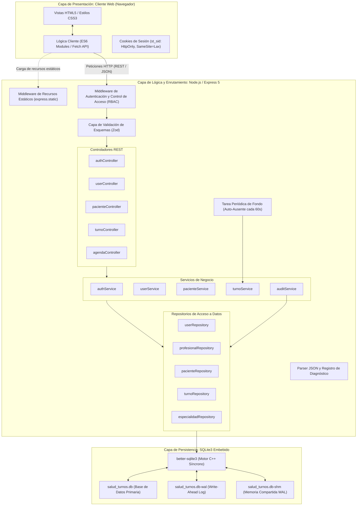
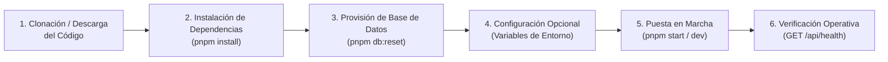
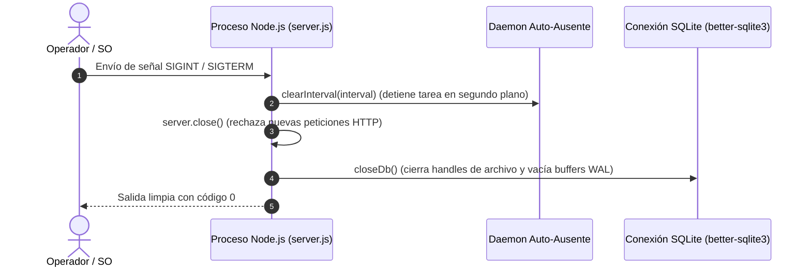

# Manual de Instalación y Configuración del Sistema

## Sistema de Gestión de Turnos Médicos — *Salud Turnos*

---

| Metadatos del Documento | Información Técnica |
| :--- | :--- |
| **Denominación del Proyecto** | Sistema de Gestión de Turnos Médicos (*Salud Turnos*) |
| **Materia** | Aplicaciones Web y Móvil - 2026 |
| **Carrera** | Licenciatura en Gestión de Recursos Tecnológicos |
| **Institución** | Universidad de Gastón Dachary |
| **Docente Titular** | Ing. Lucas M. Rodoni |
| **Autores** | Andrés Elpeza (600213) · José Benitez (600199) · Daniel Susñar (600081) |
| **Versión del Sistema** | 1.0.0 (Node.js ESM / Express 5 / SQLite3) |
| **Tipo de Documento** | Manual Técnico de Instalación, Configuración y Despliegue Operativo |

---

## 1. Introducción y Alcance

El presente documento constituye el **Manual Técnico de Instalación y Configuración** de la aplicación *Salud Turnos*, una plataforma web orientada a la administración de agendas sanitarias, gestión de pacientes, asignación y control de turnos médicos en tiempo real.

El propósito de esta guía es proporcionar a los administradores de sistemas, desarrolladores y evaluadores técnicos una descripción rigurosa, reproducible y sistemática de los pasos requeridos para aprovisionar el entorno de ejecución, instalar las dependencias de software, configurar los parámetros operativos, inicializar el esquema de base de datos relacional y verificar la operatividad de la solución.

El alcance del manual abarca:
- Requisitos mínimos y recomendados de hardware y software.
- Topología de arquitectura del sistema en capa de servidor y almacenamiento.
- Estructura y organización del repositorio de código.
- Procedimiento exhaustivo de instalación paso a paso.
- Parametrización mediante variables de entorno y opciones de configuración.
- Inicialización, sembrado (*seeding*) e integridad del motor de base de datos.
- Modos de ejecución en entornos de desarrollo y producción.
- Protocolos de verificación funcional, auditoría y resolución de incidencias (*troubleshooting*).

---

## 2. Requerimientos del Entorno de Ejecución

Para garantizar la correcta ejecución del servidor HTTP, el motor de persistencia embebido y la entrega de recursos estáticos del front-end, el entorno anfitrión debe cumplir con los siguientes requerimientos técnicos.

### 2.1. Requerimientos de Hardware

| Recurso | Requerimiento Mínimo | Requerimiento Recomendado |
| :--- | :--- | :--- |
| **Procesador (CPU)** | Arquitectura x86_64 o ARM64, 1 núcleo a 1.5 GHz | Arquitectura x86_64 o Apple Silicon, 2 o más núcleos a 2.0+ GHz |
| **Memoria RAM** | 1 GB de RAM disponible | 2 GB o más de RAM disponible |
| **Almacenamiento** | 250 MB de espacio libre en disco (incluyendo dependencias de Node.js) | 1 GB o más de espacio libre (considerando crecimiento del archivo de base de datos y logs) |
| **Red / Interfaz** | Adaptador de red con soporte TCP/IP local (*loopback* `127.0.0.1`) | Conexión Ethernet/Wi-Fi para descarga inicial de paquetes de dependencias |

### 2.2. Requerimientos de Software

| Componente | Versión Soportada | Propósito / Justificación Técnica |
| :--- | :--- | :--- |
| **Sistema Operativo** | Windows 10/11, GNU/Linux (kernel >= 5.x), macOS (>= 12 Monterey) | Compatibilidad multiplataforma nativa para entornos POSIX y Win32. |
| **Node.js** | `>= 20.0.0` (LTS recomendado: `v20.x` o `v22.x`) | Entorno de ejecución con soporte integral de módulos ECMAScript (ESM), Web Crypto y el ejecutor de pruebas nativo `node:test`. |
| **Gestor de Paquetes** | `pnpm` `>= 9.0.0` (o alternativamente `npm` `>= 10.0.0`) | Resolución determinística del árbol de dependencias mediante enlaces duros simbióticos. |
| **Herramientas de Compilación** | Python 3.x y compilador C/C++ (`build-essential` en Linux, Xcode en macOS, Visual C++ Build Tools en Windows) | Necesarias únicamente en caso de requerirse compilación local de los *bindings* binarios de `better-sqlite3` si no se dispone de binarios precompilados para la arquitectura anfitriona. |
| **Navegador Web Cliente** | Chromium `>= 100`, Firefox `>= 100`, Safari `>= 15`, Edge `>= 100` | Soporte de estándares HTML5, CSS Grid, Flexbox y API Fetch moderna. |

### 2.3. Dependencias de la Aplicación

El proyecto minimiza la dependencia de componentes de terceros, apoyándose exclusivamente en librerías maduras y de alto rendimiento:

```
├── express (^5.3.0)        -> Framework de servidor HTTP y enrutamiento modular.
├── better-sqlite3 (^13.0.3) -> Controlador síncrono nativo para SQLite con soporte WAL.
└── zod (^4.6.7)            -> Validación declarativa de esquemas y tipado en tiempo de ejecución.
```

---

## 3. Arquitectura y Topología de Despliegue

La solución adopta una **Arquitectura en Tres Capas** con acoplamiento débil entre módulos y separación estricta de responsabilidades (Presentación, Lógica de Negocio y Acceso a Datos), entregada a través de un esquema monoproceso altamente eficiente.



### 3.1. Principios de Diseño Arquitectónico

1. **Unificación de Origen (*Same-Origin*):** El servidor Express entrega tanto la API REST (`/api/*`) como los archivos estáticos del Front-End (`frontend/`). Esta configuración suprime la necesidad de configurar políticas permisivas de CORS (*Cross-Origin Resource Sharing*) y asegura la transmisión hermética de cookies de autenticación con atributos `SameSite=Lax` y `HttpOnly`.
2. **Persistencia Síncrona sin Bloqueo de E/S de Red:** El motor de base de datos se comunica mediante el conector binario `better-sqlite3`, el cual ejecuta consultas en memoria y lecturas locales de disco de forma síncrona en microsegundos, evitando la sobrecarga de eventos asíncronos para operaciones atómicas de bases de datos embebidas.
3. **Control de Concurrencia mediante Write-Ahead Logging (WAL):** La base de datos opera con el modo `journal_mode = WAL`, permitiendo lecturas concurrentes sin bloquear a los procesos de escritura y asegurando transacciones atómicas bajo el estándar ACID.
4. **Mantenimiento Autónomo en Segundo Plano:** El servidor mantiene un temporizador en memoria (`setInterval` a 60 segundos) que ejecuta la transición de turnos vencidos al estado `AUSENTE` de manera desatendida.

---

## 4. Estructura y Organización del Repositorio

El proyecto implementa una separación física y conceptual clara entre la lógica del servidor, los activos estáticos y los scripts de soporte operativo:

```
Practico3/
├── backend/                        # Núcleo del servidor y capa de datos
│   ├── data/                       # Almacenamiento físico de bases de datos SQLite
│   │   ├── salud_turnos.db         # Archivo de base de datos en producción/desarrollo
│   │   ├── salud_turnos.db-wal     # Archivo temporal de transacciones WAL
│   │   └── salud_turnos.db-shm     # Archivo de memoria compartida para índices WAL
│   ├── scripts/                    # Utilidades de mantenimiento de base de datos
│   │   ├── db-reset.js             # Script de regeneración y siembra de la BD
│   │   ├── db-export.js            # Generador de volcado SQL completo
│   │   └── hash-password.js        # Utilidad para generación de claves con scrypt
│   ├── src/                        # Código fuente modular del backend
│   │   ├── config/
│   │   │   └── index.js            # Parámetros centralizados y variables de entorno
│   │   ├── controllers/            # Controladores de solicitudes HTTP y respuestas
│   │   │   ├── agendaController.js
│   │   │   ├── authController.js
│   │   │   ├── especialidadController.js
│   │   │   ├── pacienteController.js
│   │   │   ├── turnoController.js
│   │   │   └── userController.js
│   │   ├── core/                   # Módulos transversales de infraestructura
│   │   │   ├── cookies.js          # Serialización y parseo de cookies HTTP
│   │   │   ├── errorHandler.js     # Middleware centralizado de manejo de excepciones
│   │   │   ├── errors.js           # Jerarquía de errores de dominio (HttpError)
│   │   │   ├── passwords.js        # Criptografía mediante scrypt con sal aleatoria
│   │   │   ├── text.js             # Funciones determinísticas de normalización de cadenas
│   │   │   └── time.js             # Operaciones con fechas y husos horarios
│   │   ├── db/                     # Capa de conexión y esquemas relacionales
│   │   │   ├── connection.js       # Gestor de conexión SQLite singleton y pragmas
│   │   │   ├── export.sql          # Volcado DDL y DML exportado del sistema
│   │   │   ├── schema.sql          # Definición de tablas, índices y restricciones (DDL)
│   │   │   └── seed.sql            # Datos semilla preconfigurados para demostración (DML)
│   │   ├── middleware/             # Interceptores de peticiones HTTP
│   │   │   ├── auth.js             # Validación de tokens de sesión
│   │   │   ├── roles.js            # Control de autorización basado en roles (RBAC)
│   │   │   └── validate.js         # Interceptor de esquemas Zod (body, query, params)
│   │   ├── repositories/           # Abstracción de acceso a datos y consultas SQL
│   │   │   ├── especialidadRepository.js
│   │   │   ├── pacienteRepository.js
│   │   │   ├── profesionalRepository.js
│   │   │   ├── turnoRepository.js
│   │   │   └── userRepository.js
│   │   ├── routes/                 # Definición de rutas y endpoints de la API REST
│   │   │   ├── agendaRoutes.js
│   │   │   ├── authRoutes.js
│   │   │   ├── especialidadRoutes.js
│   │   │   ├── pacienteRoutes.js
│   │   │   ├── turnoRoutes.js
│   │   │   └── userRoutes.js
│   │   ├── schemas/                # Esquemas formales de validación de datos con Zod
│   │   ├── services/               # Lógica de negocio, reglas de dominio y auditoría
│   │   │   ├── agendaService.js
│   │   │   ├── auditService.js
│   │   │   ├── authService.js
│   │   │   ├── especialidadService.js
│   │   │   ├── pacienteService.js
│   │   │   ├── turnoService.js
│   │   │   └── userService.js
│   │   └── app.js                  # Factoría de inicialización de la aplicación Express
│   ├── test/                       # Batería de pruebas automatizadas de integración
│   │   ├── agenda.test.js
│   │   ├── auth.test.js
│   │   ├── especialidades.test.js
│   │   ├── pacientes.test.js
│   │   ├── turnos.test.js
│   │   └── users.test.js
│   └── server.js                   # Punto de entrada de ejecución del servidor HTTP
├── frontend/                       # Recursos estáticos de la interfaz web
│   ├── css/                        # Hojas de estilo en cascada
│   │   └── styles.css
│   ├── images/                     # Recursos gráficos y multimedia
│   ├── js/                         # Módulos JavaScript para el navegador
│   │   ├── agenda.js
│   │   ├── common.js
│   │   ├── cuenta.js
│   │   ├── dashboard.js
│   │   ├── especialidades.js
│   │   ├── login.js
│   │   ├── pacientes.js
│   │   ├── profesionales.js
│   │   ├── turnos.js
│   │   └── usuarios.js
│   ├── agenda.html                 # Pantalla de gestión de agenda de turnos
│   ├── cuenta.html                 # Pantalla de administración de credenciales de usuario
│   ├── dashboard.html              # Panel de control con métricas e indicadores
│   ├── especialidades.html         # Catálogo de especialidades médicas
│   ├── index.html                  # Página de aterrizaje y acceso inicial
│   ├── login.html                  # Formulario de autenticación del sistema
│   ├── pacientes.html              # Registro y administración de pacientes
│   ├── profesionales.html          # Gestión de médicos y disponibilidades horarias
│   ├── turno.html                  # Solicitud y reprogramación de turnos
│   └── usuarios.html               # Administración de usuarios del sistema
├── package.json                    # Manifiesto de dependencias y scripts de ejecución
└── pnpm-lock.yaml                  # Bloqueo determinístico de versiones de paquetes
```

---

## 5. Procedimiento de Instalación Paso a Paso

A continuación se detalla la secuencia de operaciones requeridas para clonar, instalar dependencias, aprovisionar la base de datos y arrancar el sistema en una máquina limpia.



### Paso 1: Obtención del Código Fuente

Descomprima el archivo del proyecto o realice la clonación mediante Git en el directorio local de trabajo.

Verifique que se encuentre ubicado en la raíz del proyecto, donde reside el archivo `package.json`.

### Paso 2: Verificación de la Versión de Node.js

Compruebe que el entorno de ejecución instalado sea igual o superior a la versión 20.0.0:

```bash
node -v
```
*Salida esperada: `v20.x.x` o superior.*

### Paso 3: Instalación de Dependencias del Proyecto

El proyecto se gestiona prioritariamente con **pnpm** (versión recomendada 9 o 12), o en su defecto mediante **npm**. Ejecute el comando de instalación en la raíz del directorio:

**Opción A (Recomendada con pnpm):**
```bash
pnpm install
```

**Opción B (Con npm estándar):**
```bash
npm install
```

> **Nota Técnica sobre Módulos Nativos:** Durante la instalación, `better-sqlite3` descargará binarios precompilados correspondientes a la versión del motor V8 y arquitectura de su procesador. Si el sistema no cuenta con conexión a internet en ese instante o la arquitectura es atípica, se requerirá un compilador local C++ para compilar el módulo mediante `node-gyp`.

---

## 6. Configuración y Parametrización del Sistema

La configuración del sistema se centraliza en el archivo `backend/src/config/index.js`, el cual lee las propiedades desde las variables de entorno del sistema operativo con valores por defecto (*fallbacks*) diseñados para funcionamiento inmediato en entornos de desarrollo.

### 6.1. Variables de Entorno Soportadas

| Variable de Entorno | Tipo de Dato | Valor por Defecto | Descripción Técnica |
| :--- | :--- | :--- | :--- |
| `PORT` | Numérico (Entero) | `3000` | Puerto TCP en el cual el servidor Express escuchará las peticiones HTTP entrantes. |
| `DB_PATH` | Ruta (String) | `backend/data/salud_turnos.db` | Ruta absoluta o relativa al archivo SQLite donde se persiste la base de datos. |
| `NODE_ENV` | Texto | `development` | Modo de ejecución del entorno (`development`, `production`, `test`). |

### 6.2. Parámetros Criptográficos y de Sesión

Los siguientes parámetros de infraestructura de seguridad están predefinidos en la arquitectura del sistema:

| Parámetro | Valor Configurado | Significado y Seguridad |
| :--- | :--- | :--- |
| **Nombre de Cookie** | `st_sid` | Nombre identificador de la cookie de sesión enviada en los encabezados HTTP. |
| **Atributo `HttpOnly`** | `true` | Impide el acceso a la cookie mediante scripts del DOM (`document.cookie`), mitigando ataques XSS. |
| **Atributo `SameSite`** | `Lax` | Restringe el envío de la cookie en peticiones entre sitios, protegiendo contra ataques CSRF. |
| **Algoritmo de Derivación** | `scrypt` | Función de derivación de claves basada en memoria intensiva para protección ante ataques de fuerza bruta. |
| **Parámetro CPU/Memoria ($N$)** | `16384` ($2^{14}$) | Costo de iteraciones para la función `scrypt`. |
| **Parámetro Bloque ($r$)** | `8` | Tamaño del bloque de memoria interna en `scrypt`. |
| **Paralelización ($p$)** | `1` | Grado de paralelización de la función `scrypt`. |
| **Longitud de Clave Derivada** | `64` bytes (512 bits) | Tamaño del hash criptográfico resultante en formato hexadecimal. |
| **Zona Horaria del Sistema** | `America/Argentina/Buenos_Aires` | Huso horario estándar UTC-3 aplicado en cálculos de disponibilidad y fechas de turnos. |

### 6.3. Creación de un Archivo `.env` (Opcional)

Si se desea modificar el puerto predeterminado o la ubicación de la base de datos sin alterar el código fuente, es posible exportar las variables antes de iniciar el proceso o crear un archivo `.env` en la raíz del proyecto:

```ini
# Configuración del Servidor Salud Turnos
PORT=8080
DB_PATH=./backend/data/salud_turnos.db
NODE_ENV=production
```

En entornos Windows PowerShell, las variables pueden definirse temporalmente en la sesión de la consola:
```powershell
$env:PORT = "8080"
pnpm start
```

En entornos basados en Unix (Linux / macOS):
```bash
PORT=8080 pnpm start
```

---

## 7. Inicialización y Aprovisionamiento de la Base de Datos

El sistema no requiere de un servidor de bases de datos externo (como PostgreSQL o MySQL), ya que utiliza **SQLite3** embebido a nivel de proceso. Sin embargo, para operar adecuadamente es indispensable que el esquema relacional y los datos iniciales se encuentren materializados en el disco.

### 7.1. Estructura del Esquema Relacional

El modelo de datos implementado en `backend/src/db/schema.sql` contiene las siguientes entidades y restricciones:

| Tabla | Clave Primaria | Restricciones de Integridad / Índices Clave | Propósito |
| :--- | :--- | :--- | :--- |
| **`usuario`** | `id_usuario` (Autoinc) | `UNIQUE (correo)`, `CHECK (rol IN ('ADMINISTRADOR', 'RECEPCIONISTA', 'PROFESIONAL'))` | Control de cuentas, autenticación y credenciales con contraseñas hasheadas. |
| **`sesion`** | `id_sesion` (Hash SHA-256) | `FOREIGN KEY (id_usuario)`, `UNIQUE (id_usuario)` | Gestión de sesión única activa por usuario en memoria/base de datos. |
| **`especialidad`** | `id_especialidad` (Autoinc) | `UNIQUE (nombre)`, `CHECK (estado IN (0, 1))` | Catálogo de especialidades médicas de la institución. |
| **`profesional`** | `id_profesional` (Autoinc) | `UNIQUE (matricula)`, `UNIQUE (id_usuario)`, `INDEX ux_profesional_consultorio_clave` | Profesionales de la salud, vinculación de usuario y control de consultorios. |
| **`disponibilidad`** | `id_disponibilidad` (Autoinc) | `FOREIGN KEY (id_profesional)`, `CHECK (hora_inicio < hora_fin)` | Franjas horarias semanales de atención (bloques parametrizados en 30 minutos). |
| **`paciente`** | `id_paciente` (Autoinc) | `UNIQUE (dni)`, `CHECK (length(dni) BETWEEN 7 AND 8)` | Padrón de pacientes con datos de contacto y cobertura médica. |
| **`turno`** | `id_turno` (Autoinc) | `ux_turno_slot_profesional`, `ux_turno_slot_paciente` | Asignación de turnos médicos con control estricto de concurrencia y solapamiento. |
| **`auditoria`** | `id_auditoria` (Autoinc) | `FOREIGN KEY (id_usuario)`, `INDEX idx_auditoria_entidad` | Trazabilidad obligatoria de mutaciones de datos con estado previo y posterior (JSON). |

### 7.2. Ejecución del Script de Inicialización (`pnpm db:reset`)

Para inicializar la base de datos desde cero o restablecerla a su estado predeterminado de fábrica (eliminando tablas preexistentes, aplicando el esquema DDL y cargando los datos iniciales DML), ejecute:

```bash
pnpm db:reset
```

**Comportamiento interno del script:**
1. Cierra cualquier conexión abierta al motor SQLite.
2. Elimina de manera segura los archivos físicos en `backend/data/`: `salud_turnos.db`, `salud_turnos.db-wal` y `salud_turnos.db-shm`.
3. Crea una nueva base de datos configurada con `PRAGMA journal_mode = WAL` y `PRAGMA foreign_keys = ON`.
4. Registra la función determinística `normalizar(cadena)` utilizada en el motor para búsquedas agnósticas de acentos y mayúsculas.
5. Ejecuta en una transacción atómica el script `backend/src/db/schema.sql`.
6. Inserta los registros predeterminados provistos en `backend/src/db/seed.sql`.

*Salida esperada en terminal:*
```text
[Base de Datos] Reinicializada con éxito en: .../backend/data/salud_turnos.db
```

### 7.3. Exportación de Respaldo del Esquema y Datos (`pnpm db:export`)

El sistema incluye una utilidad para generar un volcado SQL íntegro (esquema DDL completo, índices y sentencias DML `INSERT` de todos los registros):

```bash
pnpm db:export
```
El archivo de volcado resultante se depositará en:
`backend/src/db/export.sql`

---

## 8. Puesta en Marcha y Modos de Ejecución

Una vez instaladas las dependencias e inicializada la base de datos, el servidor puede ser ejecutado bajo dos modalidades según el propósito operativo.

### 8.1. Modo Estándar de Producción (`pnpm start`)

Inicia el servidor Node.js sin sobrecargas de observación de archivos en el sistema de ficheros:

```bash
pnpm start
```

*Salida esperada por consola:*
```text
[Salud Turnos] Servidor escuchando en http://localhost:3000
```

### 8.2. Modo de Desarrollo con Recarga Automática (`pnpm dev`)

Inicia el entorno utilizando el flag nativo de Node.js `--watch`, el cual monitoriza cambios en los archivos JavaScript y reinicia el proceso del servidor de forma instantánea:

```bash
pnpm dev
```

### 8.3. Mecanismo de Parada Ordenada (*Graceful Shutdown*)

El servidor implementa interceptores para las señales del sistema operativo `SIGINT` (Ctrl+C en la consola) y `SIGTERM` (orden de finalización de procesos de orquestadores o del sistema operativo):



Este procedimiento garantiza que no se produzcan escrituras truncadas en el archivo WAL de la base de datos al detener el proceso.

---

## 9. Credenciales Preconfiguradas para Pruebas y Validación

### 9.1. Cuentas del Sistema Sembradas Inicialmente

La siembra inicial de la base de datos (`seed.sql`) provee cuentas de acceso de demostración para cada uno de los roles contemplados en el sistema de control de acceso.

> **Importante sobre la Política de Contraseñas:** Todas las contraseñas preconfiguradas satisfacen de forma estricta los criterios de complejidad validados por el esquema Zod: longitud mínima de 8 caracteres, al menos una letra mayúscula, al menos una letra minúscula y al menos un carácter especial (`#`, `@`, `$`, etc.).

| Rol de Usuario | Correo Electrónico | Contraseña Predefinida | Alcance y Atribuciones Técnicas |
| :--- | :--- | :--- | :--- |
| **Administrador** | `admin@saludturnos.com` | `SaludTurnos#2026` | Control total del sistema: gestión de cuentas de usuarios, alta/baja de especialidades médicas, administración de profesionales y visualización global de auditoría. |
| **Recepcionista** | `recepcion@saludturnos.com` | `Recepcion#2026` | Operación de mesa de entradas: gestión de pacientes, otorgamiento, consulta, reprogramación y cancelación de turnos, y registro de arribo de pacientes al consultorio. |
| **Profesional** | `laura.gomez@saludturnos.com` | `LauraGomez#2026` | Dra. Laura Gómez (Clínica Médica - Consultorio 101). Acceso a su propia agenda médica y actualización del estado de sus turnos asignados. |
| **Profesional** | `martin.perez@saludturnos.com` | `MartinPerez#2026` | Dr. Martín Pérez (Pediatría - Consultorio 102). Acceso a la agenda y pacientes propios. |
| **Profesional** | `carla.nunez@saludturnos.com` | `CarlaNunez#2026` | Dra. Carla Núñez (Cardiología - Consultorio 103). Acceso a la agenda y pacientes propios. |

### 9.2. Justificación de Diseño y Seguridad: Notificación de Credenciales en Nuevos Usuarios

> **Declaración Técnica de Alcance:**  
> En una arquitectura orientada a entornos de producción, la exposición o renderizado de contraseñas en texto plano dentro de la interfaz gráfica de usuario representa un antipatrón de seguridad. El estándar de la industria exige canalizar la entrega de credenciales a través de un canal fuera de banda (*out-of-band*), típicamente mediante un servidor de mensajería SMTP configurado para despachar un enlace seguro con un token temporal de activación o restablecimiento (*password reset link*).
>
> Sin embargo, dentro del alcance delimitado de este proyecto académico y aplicativo local, se prescinde deliberadamente de una infraestructura de correo electrónico o pasarela de mensajería externa, a fin de preservar la total portabilidad y autosuficiencia del entorno sin requerir dependencias de red de terceros. Por tal razón, la contraseña temporal generada al registrar un nuevo usuario es mostrada excepcionalmente en la interfaz de la aplicación, con el único propósito de **completar el circuito funcional de prueba** y permitir al evaluador o administrador verificar de inmediato el flujo de autenticación y los permisos del perfil creado.

---

## 10. Verificación Operativa y Suite de Pruebas

Para garantizar que la instalación se ha completado de manera íntegra, deben llevarse a cabo las siguientes comprobaciones.

### 10.1. Verificación del Endpoint de Salud (*Health Check*)

Abra una consola o cliente HTTP (por ejemplo `curl`) y realice una petición de comprobación al endpoint de diagnóstico:

```bash
curl -i http://localhost:3000/api/health
```

**Respuesta HTTP esperada:**
```http
HTTP/1.1 200 OK
Content-Type: application/json; charset=utf-8

{
  "ok": true,
  "mensaje": "Salud Turnos API en línea"
}
```

### 10.2. Verificación de la Interfaz Web en Navegador

1. Abra un navegador web moderno (Google Chrome, Mozilla Firefox, Microsoft Edge o Safari).
2. Navegue hacia la dirección local: `http://localhost:3000/login.html` (o `http://localhost:3000/`).
3. Ingrese las credenciales del perfil Administrador (`admin@saludturnos.com` / `SaludTurnos#2026`).
4. Verifique que la aplicación redireccione correctamente al panel de control principal (`dashboard.html`) y que la cookie `st_sid` haya sido generada en el almacenamiento del navegador.

### 10.3. Ejecución de la Batería de Pruebas Automatizadas

El proyecto cuenta con una suite de pruebas automatizadas de integración basadas en el ejecutor nativo `node:test`. Dichas pruebas verifican el aislamiento criptográfico, la persistencia en bases de datos aisladas en memoria/disco temporal y las respuestas HTTP de los servicios:

```bash
pnpm test
```

*La suite evalúa:*
- Algoritmos de hashing (`scrypt`) y normalización determinística de cadenas.
- Serialización, expiración y parseo de cookies de autenticación.
- Ciclo de vida completo de autenticación y control de sesión única.
- Operaciones sobre especialidades, usuarios y profesionales.
- Validación de esquemas Zod en altas y modificaciones de pacientes.
- Máquina de estados de turnos y reglas de concurrencia para evitar solapamientos de horario en consultorios.

---

## 11. Resumen de Scripts CLI Disponibles

A modo de referencia rápida, a continuación se enumeran los comandos definidos en el archivo `package.json`:

| Comando | Comando Subyacente | Finalidad Operativa |
| :--- | :--- | :--- |
| `pnpm start` | `node backend/server.js` | Inicia el servidor de aplicaciones en el puerto configurado (3000 por defecto). |
| `pnpm dev` | `node --watch backend/server.js` | Inicia el servidor con reinicio reactivo ante modificaciones de archivos de código. |
| `pnpm db:reset` | `node backend/scripts/db-reset.js` | Restablece completamente el esquema y la base de datos a su estado inicial. |
| `pnpm db:export` | `node backend/scripts/db-export.js` | Genera un volcado completo de la estructura y los datos en formato SQL estándar. |
| `pnpm test` | `node --test --test-concurrency=1 backend/test/**/*.test.js` | Ejecuta de forma secuencial la suite completa de pruebas unitarias y de integración. |

---

## 12. Diagnóstico y Resolución de Problemas (*Troubleshooting*)

A continuación se catalogan las anomalías e incidencias más comunes que pueden presentarse durante el despliegue del sistema, acompañadas de sus causas raíz y soluciones técnicas correspondientes.

### 12.1. Matriz de Resolución de Incidencias

| Síntoma / Mensaje de Error | Causa Raíz Probable | Procedimiento de Resolución |
| :--- | :--- | :--- |
| `Error: listen EADDRINUSE: address already in use :::3000` | El puerto TCP 3000 está siendo utilizado por otra instancia previa del servidor o por otra aplicación. | **1.** Identifique el proceso en ejecución (`netstat -ano \| findstr :3000` en Windows o `lsof -i :3000` en Linux/macOS) y termínelo.<br>**2.** Alternativamente, ejecute el servidor en otro puerto configurando la variable de entorno: `PORT=3005 pnpm start`. |
| `SqliteError: unable to open database file` | El directorio de destino `backend/data/` no existe o el proceso carece de permisos de escritura en el sistema de archivos. | **1.** Verifique que la ruta exista o créela manualmente (`mkdir backend/data`).<br>**2.** Revise los permisos del usuario del sistema operativo sobre el directorio de trabajo. |
| `SqliteError: database is locked` | Múltiples procesos o hilos están intentando escribir simultáneamente en el archivo SQLite fuera del modo WAL. | **1.** Compruebe que no haya instancias duplicadas del servidor abiertas.<br>**2.** Ejecute `pnpm db:reset` para reconstruir los archivos auxiliares `-wal` y `-shm`. |
| `Error: Cannot find module 'better-sqlite3'` o fallo en carga de binario `.node` | Las dependencias nativas en C++ no se compilaron o corresponden a una versión distinta del motor de Node.js. | Ejecute una reinstalación limpia de dependencias: elimine la carpeta `node_modules` y ejecute `pnpm install` (o `npm rebuild better-sqlite3`). |
| Redirección inmediata a `login.html` tras intentar navegar a una pantalla privada | La cookie de sesión `st_sid` no fue recibida por el servidor, ha expirado, o el navegador bloquea cookies de origen local. | **1.** Verifique que el navegador tenga habilitadas las cookies.<br>**2.** Inicie sesión nuevamente en `http://localhost:3000/login.html` utilizando las credenciales provistas en la Sección 9.<br>**3.** Asegúrese de acceder mediante `http://localhost:3000` y no abriendo los archivos HTML directamente mediante el protocolo `file:///`. |
| El navegador muestra `404 Not Found` al acceder a estilos o scripts | Se está ejecutando un servidor web independiente apuntando solo al frontend en lugar del servidor Express. | Inicie la aplicación mediante `pnpm start` o `pnpm dev`. El servidor de Node.js sirve de manera integral los archivos estáticos desde `backend/src/app.js`. |

---

## 13. Mantenimiento Preventivo y Políticas de Respaldo

Para asegurar la disponibilidad, integridad y rendimiento a largo plazo de la base de datos relacional embebida, se establecen las siguientes directivas y procedimientos técnicos de mantenimiento:

### 13.1. Procedimiento de Respaldo Físico Caliente (*Hot Backup*)

Dado que el motor SQLite opera con el modo WAL (*Write-Ahead Logging*) activo, es factible generar copias de seguridad consistentes en caliente sin interrumpir el servicio ni bloquear las lecturas de los usuarios. Puede utilizarse la utilidad del proyecto o la herramienta de línea de comandos de SQLite:

```bash
# Opción A: Utilidad del proyecto (exportación DDL y DML estructurada)
pnpm db:export

# Opción B: Copia de seguridad atómica binaria con SQLite CLI
sqlite3 backend/data/salud_turnos.db ".backup 'backend/data/backup_$(date +%Y%m%d).db'"
```

### 13.2. Compactación y Optimización Interna del Motor (`PRAGMA optimize;` y `VACUUM;`)

A medida que el sistema procesa transacciones —en particular cambios frecuentes de estado de turnos, cancelaciones y el registro acumulativo de mutaciones JSON en la tabla `auditoria`—, se recomienda ejecutar periódicamente las instrucciones de optimización y desfragmentación del motor:

```sql
PRAGMA optimize;
VACUUM;
```

#### Fundamento y Mecanismo Técnico:

1. **`VACUUM;` (Compactación física y eliminación de la *Freelist*):**  
   SQLite organiza su almacenamiento en bloques de tamaño fijo denominados páginas (4096 bytes). Cuando se eliminan registros o se actualizan campos de texto variable, SQLite **no devuelve automáticamente el espacio al sistema operativo**, sino que marca dichas páginas como reutilizables dentro de una lista interna (*freelist*). Con el tiempo, esto genera fragmentación interna en el disco. La instrucción `VACUUM` reconstruye completamente la base de datos en un archivo temporal contiguo, elimina las páginas huérfanas, devuelve el espacio libre al disco y reordena los árboles B (*B-Trees*), acelerando las operaciones de lectura de entrada/salida (I/O).

2. **`PRAGMA optimize;` (Actualización de estadísticas del planificador de consultas):**  
   El optimizador de consultas de SQLite (*Query Planner*) se basa en estadísticas de distribución de datos (almacenadas en `sqlite_stat1`) para determinar si conviene utilizar índices específicos (como `ux_turno_slot_profesional` o `idx_auditoria_entidad`) o realizar un escaneo completo de tabla (*Full Table Scan*). Ejecutar `PRAGMA optimize;` analiza de forma inteligente las consultas recientes y corre internamente el comando `ANALYZE` **únicamente sobre aquellos índices cuyas tablas hayan sufrido variaciones significativas**, garantizando tiempos de respuesta mínimos sin incurrir en bloqueos innecesarios.

#### Modo de Ejecución Rápida:
Puede aplicarse directamente desde la consola CLI de SQLite:
```bash
sqlite3 backend/data/salud_turnos.db "PRAGMA optimize; VACUUM;"
```
O integrarse mediante una llamada síncrona con el conector nativo:
```javascript
import { getDb, closeDb } from './backend/src/db/connection.js';

const db = getDb();
db.pragma('optimize');
db.exec('VACUUM;');
closeDb();
```

### 13.3. Monitoreo y Gestión del Archivo WAL (*Write-Ahead Log*)

El archivo auxiliar `backend/data/salud_turnos.db-wal` almacena temporalmente las transacciones confirmadas antes de consolidarlas en el archivo principal `.db`. Se debe vigilar que su tamaño permanezca acotado (habitualmente unos pocos kilobytes o megabytes). El conector `better-sqlite3` ejecuta puntos de control automáticos (*checkpoints*), pero ante reinicios forzosos o bloqueos anómalos, el comando `pnpm db:reset` o un cierre limpio mediante el protocolo *Graceful Shutdown* reestablecerán la sincronización íntegra.

